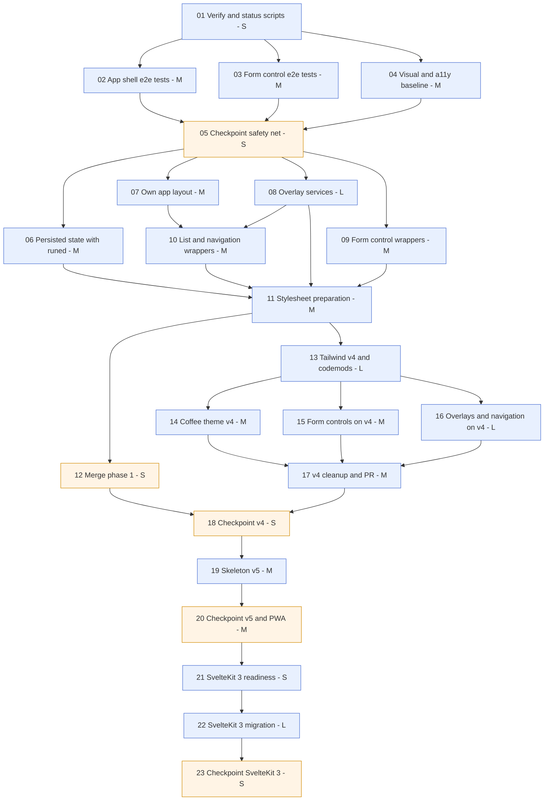

# Epic 0001: Migrate to Skeleton v5, Tailwind v4 and SvelteKit 3

**Status:** In progress
**Created:** 2026-10-23

## Summary

Coffee Pal runs on Skeleton v2 (`@skeletonlabs/skeleton` 2.11 + `@skeletonlabs/tw-plugin`), Tailwind CSS 3.4 and SvelteKit 2. Skeleton v2 and the Tailwind v3 plugin are end-of-life, and they block the Tailwind v4 upgrade. This epic moves the app to Skeleton v5, Tailwind v4 and finally SvelteKit 3. It does this in small, verifiable phases, so Claude can do most of the work on its own and the human only steps in at a few checkpoints. The app adopts the new Skeleton look; only the coffee colours and the mesh background are carried over.

## Goals

- `@skeletonlabs/skeleton` / `@skeletonlabs/skeleton-svelte` at v5.x; `@skeletonlabs/tw-plugin` removed.
- `tailwindcss` at v4.x via `@tailwindcss/vite`; `tailwind.config.ts`, `postcss.config.js`, `autoprefixer` and `@tailwindcss/container-queries` removed.
- `@sveltejs/kit` at v3.x, with `svelte.config.js` folded into `vite.config.ts`.
- No feature regressions: all existing and new e2e tests pass, the PWA still installs and works offline, and users keep their settings and sync connection (localStorage keys `settings` and `sync`).
- No new accessibility violations compared with the baseline taken in story 04.
- Production runs Skeleton v4 + Tailwind v4 (stable stop) before the v5 step begins.

## Non-goals

- Pixel-identical look. The new Skeleton look is adopted on purpose (decision 2026-10-23).
- New features, or redesigning screens beyond what the component swap needs.
- Replacing Skeleton with another UI library.
- Other dependency upgrades not required by the migration. Dependabot keeps handling those after the epic; its PRs aren't merged while the epic runs (see Risks).

## Background & context

- **Skeleton v2 usage:** 31 of 86 `.svelte` files. Components used: `AppShell`, `AppBar`, `AppRail`/`AppRailAnchor`, `Drawer`, `Modal`, `Toast` (+ `getDrawerStore`/`getModalStore`/`getToastStore`, 11 files), `popup`/`storePopup` (3 files), `Autocomplete` (2 components, plus the `AutocompleteOption` type in `brewMethods.ts`), `ListBox`, `Paginator`, `InputChip`, `FileDropzone`, `RangeSlider`, `Ratings`, `ConicGradient` ([Spinner.svelte](../../src/lib/components/shared/elements/Spinner.svelte)), `SlideToggle`, `RadioGroup`/`RadioItem`, and `localStorageStore` ([settings.ts](../../src/lib/stores/settings.ts), [sync.ts](../../src/lib/stores/sync.ts)). Stores and providers are set up in [AppLayout.svelte](../../src/lib/components/shared/app/AppLayout.svelte).
- **Styling:** [src/app.scss](../../src/app.scss) (Sass, `@tailwind` directives, global overrides that `@apply` Skeleton classes such as `variant-filled-primary` and `bg-surface-50-900-token`); one more component uses `lang="scss"` ([AppDragHandle.svelte](../../src/lib/components/shared/app/AppDragHandle.svelte)); 37 files use `variant-*` or `*-token` classes; 4 files use `input-group`. Custom theme in [theme.ts](../../theme.ts) (RGB-triplet `CustomThemeConfig`), registered in [tailwind.config.ts](../../tailwind.config.ts) together with `@tailwindcss/forms`, `@tailwindcss/container-queries` and custom screens from [src/lib/config/screens.ts](../../src/lib/config/screens.ts).
- **SvelteKit:** 2.70 with Svelte 5.56, `svelte.config.js` (adapter switch `USE_ADAPTER_BUN`, `$assets`/`$lib` aliases, `onwarn` filter), `$app/stores` in 5 files, 201 `$lib/...` imports without a file extension, PWA via `@vite-pwa/sveltekit` with `injectManifest` and [src/service-worker.ts](../../src/service-worker.ts).
- **Tests:** 5 Playwright specs in [tests/specs](../../tests/specs) (~650 lines, mostly role/label selectors, a few Skeleton-coupled ones: `.modal`, `data-testid="radio-item"`), unit tests via Vitest. [CI](../../.github/workflows/ci.yaml) runs lint, check and unit tests on PRs; the [Test workflow](../../.github/workflows/test.yaml) runs Playwright against each successful (Vercel) deployment. There are no visual or accessibility tests today.
- **Official migration paths (checked 2026-10-23):**
  - Skeleton has no direct v2 → v5 path. v2 → v4 follows the [archived v2 → v4 guide](https://v4.skeleton.dev/docs/svelte/get-started/migrate-from-v2) (codemods `npx skeleton@latest migrate skeleton-3`, then `skeleton-4`, plus manual component work). v4.15.2 → v5 follows the [v4 → v5 guide](https://www.skeleton.dev/docs/svelte/get-started/migrate-from-v4) (codemod `skeleton-5` plus manual fixes).
  - Tailwind v4 requires dropping Sass, and Skeleton v3+ requires Tailwind v4, so these two must switch together.
  - SvelteKit 3: [migration guide](https://svelte.dev/docs/kit/migrating-to-sveltekit-3), codemod `npx sv migrate sveltekit-3`. Needs Vite 8 and TypeScript 6, removes `svelte.config.js`, replaces `$lib` with `#lib` (explicit file paths), and changes the service worker modules.

## Proposed approach

"Approach B": do as much as possible while the app still works on v2, so the period where the app is broken is short and limited to a few folders.

| Phase                       | Branch                                         | Stories | Lands on `main`                                  |
| --------------------------- | ---------------------------------------------- | ------- | ------------------------------------------------ |
| 0 Safety net                | `migration/0-safety-net`                       | 01–05   | at checkpoint 05                                 |
| 1 Decouple (still v2)       | `migration/1-decouple`                         | 06–12   | at 12 (non-blocking)                             |
| 2 Tailwind v4 + Skeleton v4 | `migration/2-skeleton-v4` (stacked on phase 1) | 13–18   | at checkpoint 18 → **stable stop in production** |
| 3 Skeleton v5               | `migration/3-skeleton-v5`                      | 19–20   | at checkpoint 20                                 |
| 4 SvelteKit 3               | `migration/4-sveltekit-3`                      | 21–23   | at checkpoint 23                                 |

Key design decisions:

- **An anti-corruption layer.** After phase 1, only `src/lib/components/shared/ui/` (wrapper components named after the v4/v5 components: `Switch`, `SegmentedControl`, `Slider`, `RatingGroup`, `TagsInput`, `FileUpload`, `Combobox`, `Listbox`, `Pagination`, `Popover`, `NavRail`, `AppBar`, plus `ModalHost`/`ToastHost`/`DrawerHost`) and `src/lib/services/ui/` (`modal`, `toast`, `drawer` services with a promise/function API) know about Skeleton. Phases 2 and 3 then rewrite the _inside_ of those files, not 31 call sites.
- **Wrappers are thin and app-shaped.** Props describe what the app needs (`bind:value`, `label`, `options`, …), not the v2 API. This avoids carrying the v2 API forward.
- **Persisted state via [runed `PersistedState`](https://runed.dev/docs/utilities/persisted-state)** replaces `localStorageStore` (decision 2026-10-23), with the same localStorage keys and format so existing users keep their data.
- **The coffee theme is converted by hand** (no Theme Generator), decision 2026-10-23.
- **Codemods first, then manual work.** Each codemod run is its own commit so it can be reverted and its diff reviewed separately.
- **The broken phase is driven by failing tests.** In phase 2, wrappers that don't compile yet are replaced by placeholders marked `MIGRATION_PLACEHOLDER`. The branch builds again quickly, and the failing e2e tests plus the placeholder count become the to-do list.

### How Claude works through this epic (autonomy loop)

Decision 2026-10-23: Claude works on the phase branch and stops only at the Human checkpoint stories (05, 12, 18, 20, 23) or when a stop rule fires.

1. Pick the next story whose dependencies are done, and set its status to In progress in this README and in the story.
2. Implement it. Commit in small steps with Conventional Commit messages (commitlint is enforced), for example `refactor(ui): wrap SlideToggle in ui/Switch`.
3. Run the gates for the current phase (see below) until they pass.
4. Run `pnpm migration:status --phase <N>` and append a dated entry to [PROGRESS.md](PROGRESS.md): story, status numbers, gate results, notable decisions, open issues.
5. Mark the story Done (checkboxes + status) and continue.

**Gates per phase** (all scripts come from story 01 or 04):

| Phase | Required green                                                                                                                                                            | Visual check                                                                                                                   |
| ----- | ------------------------------------------------------------------------------------------------------------------------------------------------------------------------- | ------------------------------------------------------------------------------------------------------------------------------ |
| 0     | `pnpm verify`                                                                                                                                                             | baseline created                                                                                                               |
| 1     | `pnpm verify:strict` (screenshots must still match the v2 baseline, `maxDiffPixelRatio` 0.01)                                                                             | strict                                                                                                                         |
| 2     | 13–16: `check`/`lint`/`build`/`test:unit` green, the specs for the story's components green, and the failing-test list in PROGRESS.md never grows. 17: full `pnpm verify` | Claude reviews diffs against the v2 baseline as a judgment check; after approval at checkpoint 18 the v4 baseline is committed |
| 3     | `pnpm verify`; at the end the baseline is regenerated and `pnpm verify:strict` passes again                                                                               | new baseline, strict from here                                                                                                 |
| 4     | `pnpm verify:strict`                                                                                                                                                      | strict                                                                                                                         |

**Stop rules.** Claude stops and asks the human when:

- a v4/v5 component can't do what the app needs, and the only fix is a behaviour or UX change;
- the same gate failure persists after 3 genuine fix attempts;
- a codemod produces output that looks wrong or deletes logic;
- a required package has no version compatible with the target (story 21);
- a change would alter stored user data or its format (localStorage, IndexedDB/Dexie, backup files);
- anything needs secrets, Vercel or GitHub settings, or a production check.

**Pushing:** Claude pushes the phase branch and opens or updates the draft PR. Merging into `main` (which triggers semantic-release and deployment) is always done by the human in a checkpoint story.

**Releases and deploys:** Vercel builds every branch push (previews), but on `main` it builds **only** `chore(release):` commits ([scripts/trigger-new-build.js](../../scripts/trigger-new-build.js) is the ignored-build step). So a phase reaches production only if its squash-merge title makes semantic-release cut a release ([.releaserc.json](../../.releaserc.json), `conventionalcommits` preset plus `chore(deps)` → patch). The production Test workflow then runs on the release commit's deployment, not on the merge commit.

| Phase | Squash-merge title (set by Claude as the PR title)                                                                                                                                                 | Release      | Production deploy |
| ----- | -------------------------------------------------------------------------------------------------------------------------------------------------------------------------------------------------- | ------------ | ----------------- |
| 0     | `fix: add test hooks for migration safety net (migration phase 0)` if `git diff main -- src` isn't empty (new `data-testid`s etc.), otherwise `test: add migration safety net (migration phase 0)` | patch / none | yes / none        |
| 1     | `fix: decouple app from Skeleton v2 (migration phase 1)`                                                                                                                                           | patch        | yes               |
| 2     | `feat: move to Tailwind v4 and Skeleton v4 (migration phase 2)`                                                                                                                                    | minor        | yes               |
| 3     | `feat: move to Skeleton v5 (migration phase 3)`                                                                                                                                                    | minor        | yes               |
| 4     | `chore(deps): upgrade to SvelteKit 3 (migration phase 4)`                                                                                                                                          | patch        | yes               |

**Force-pushing:** Claude may force-push only its own `migration/*` phase branch, only with `--force-with-lease`, and only after a rebase (see Assumptions). Never `main`, and never a branch the human has pushed commits to.

## Stories

| #   | Story                                                                        | Owner  | Size | Depends on     | Status |
| --- | ---------------------------------------------------------------------------- | ------ | ---- | -------------- | ------ |
| 01  | [Verify and migration-status scripts](01-verify-and-status-scripts.md)       | Claude | S    | –              | Done   |
| 02  | [E2e tests for app shell and overlays](02-app-shell-e2e-tests.md)            | Claude | M    | 01             | Done   |
| 03  | [E2e tests for form controls](03-form-control-e2e-tests.md)                  | Claude | M    | 01             | Done   |
| 04  | [Visual and accessibility baseline](04-visual-and-a11y-baseline.md)          | Claude | M    | 01             | Done   |
| 05  | [Checkpoint: approve safety net](05-checkpoint-safety-net.md)                | Human  | S    | 02, 03, 04     | Done   |
| 06  | [Persisted state with runed](06-persisted-state-runed.md)                    | Claude | M    | 05             | Done   |
| 07  | [Own app layout instead of AppShell](07-own-app-layout.md)                   | Claude | M    | 05             | Done   |
| 08  | [Overlay services and hosts](08-overlay-services.md)                         | Claude | L    | 05             | Done   |
| 09  | [Form control wrappers](09-form-control-wrappers.md)                         | Claude | M    | 05             | Done   |
| 10  | [List and navigation wrappers](10-list-navigation-wrappers.md)               | Claude | M    | 07, 08         | Done   |
| 11  | [Stylesheet preparation](11-stylesheet-preparation.md)                       | Claude | M    | 06, 08, 09, 10 | Done   |
| 12  | [Merge phase 1 and check production data](12-merge-phase-1.md)               | Human  | S    | 11             | Done   |
| 13  | [Tailwind v4 and Skeleton codemods](13-tailwind-v4-and-codemods.md)          | Claude | L    | 11             | Done   |
| 14  | [Coffee theme for Skeleton v4](14-coffee-theme-v4.md)                        | Claude | M    | 13             | Done   |
| 15  | [Form control wrappers on v4](15-form-controls-v4.md)                        | Claude | M    | 13             | Done   |
| 16  | [Overlays, lists and navigation on v4](16-overlays-navigation-v4.md)         | Claude | L    | 13             | Done   |
| 17  | [Skeleton v4 cleanup and PR](17-v4-cleanup.md)                               | Claude | M    | 14, 15, 16     | Done   |
| 18  | [Checkpoint: approve v4 and ship](18-checkpoint-v4.md)                       | Human  | S    | 12, 17         | Todo   |
| 19  | [Skeleton v5 upgrade](19-skeleton-v5.md)                                     | Claude | M    | 18             | Todo   |
| 20  | [Checkpoint: approve v5 and test PWA on device](20-checkpoint-v5-and-pwa.md) | Human  | M    | 19             | Todo   |
| 21  | [SvelteKit 3 readiness check](21-sveltekit-3-readiness.md)                   | Claude | S    | 20             | Todo   |
| 22  | [SvelteKit 3 migration](22-sveltekit-3-migration.md)                         | Claude | L    | 21             | Todo   |
| 23  | [Checkpoint: approve SvelteKit 3 and ship](23-checkpoint-sveltekit-3.md)     | Human  | S    | 22             | Todo   |

**Size overview:** 6×S, 13×M, 4×L. Claude: 2×S, 12×M, 4×L. Human: 4×S, 1×M. Largest risks: 08 (overlay services, since v4 drops the store-based modal/toast/drawer model), 13 (Tailwind v4 + two codemods at once, the moment the app breaks), 16 (rewriting the most interactive components on Zag.js-based v4 components), 22 (SvelteKit 3 plus the PWA tooling).

This epic has more stories than usual (23). It covers three major upgrades with five human checkpoints, and every Claude story is kept to at most one gate-to-gate step.

## Story order

## Risks & open questions

- **Skeleton v4 component coverage.** Confirmed 2026-10-25: `@skeletonlabs/skeleton-svelte@4.15.2` ships `Listbox` and `AppBar` (plus every other component the wrappers need), so story 16 needs no custom fallbacks.
- **`*-token` classes.** The v2 → v4 guide doesn't say whether the `skeleton-3` codemod rewrites `*-token` classes (e.g. `bg-surface-50-900-token`). Story 13 measures what's left; story 17 removes the rest by hand.
- **Codemods on wrapped code.** The codemods are written for typical v2 apps; output on the `ui/` wrappers may need hand fixes. Each run is a separate commit, so it's easy to revert.
- **Screenshot determinism.** Visual tests need stable data, fonts and animations. They run only locally on macOS (Playwright stores per-platform snapshots) and never in GitHub Actions. If they're flaky, story 04 increases masking and thresholds before the baseline is approved.
- **PWA tooling for SvelteKit 3.** `@vite-pwa/sveltekit` and `svelte-adapter-bun` may lag behind. Story 21 is a go/no-go gate; phase 4 waits if they're not ready.
- **Data compatibility.** `PersistedState` must read the existing `settings`/`sync` values written by `localStorageStore`. So must the inline script in [src/app.html](../../src/app.html), which reads `settings.colorScheme` before hydration to avoid a light flash; it must keep working unchanged. This is covered by unit tests in 06 and a production check in 12.
- **Vercel preview deployments for branches.** Confirmed: [scripts/trigger-new-build.js](../../scripts/trigger-new-build.js) lets Vercel build every non-`main` branch, so pushes to `migration/*` create previews and trigger the Test workflow (`deployment_status`) against them. Test runs against `migration/2-skeleton-v4` previews will be red during 13–16 by design (placeholders); they're expected to be green again from 17. Claude ignores them until then; the human can too.
- **Dependabot.** [.github/dependabot.yaml](../../.github/dependabot.yaml) already ignores all major updates, so it never proposes the migration targets. Its monthly grouped minor/patch PR would conflict with phase branches in `pnpm-lock.yaml`. Decision 2026-10-24: the human doesn't merge Dependabot PRs until the epic is done; no config change. If a security fix must be merged meanwhile, Claude rebases the open phase branch afterwards and regenerates the lockfile.

## Assumptions

- "Work on a branch, stop only at checkpoints" means: one branch per phase, a draft PR per phase, Claude pushes the branch freely, and only the human merges to `main`.
- Phase PRs are squash-merged (repo default). Phase 1 ships to production on its own (story 12), but doesn't block phase 2:
  - `migration/2-skeleton-v4` is branched from `migration/1-decouple`, and its draft PR targets `migration/1-decouple` (clean diff). CI runs on it through the `migration/**` pull-request trigger added in story 01.
  - If `migration/1-decouple` gets new commits before it is merged (e.g. review fixes in story 12), Claude rebases `migration/2-skeleton-v4` onto the new tip.
  - Once 12 is merged, Claude transplants phase 2 onto `main`: `git rebase --onto origin/main <PHASE1_TIP> migration/2-skeleton-v4`, where `<PHASE1_TIP>` is the merged PR's head SHA (`gh pr view <PR> --json headRefOid`), not the branch name (it may be deleted). Then Claude re-runs the phase 2 gate, pushes with `--force-with-lease` and changes the PR base to `main` (`gh pr edit <PR> --base main`). Expected conflicts are small (`package.json` version from the release commit, `pnpm-lock.yaml` → regenerate with `pnpm install`).
- `PersistedState`'s `syncTabs` stays at its default (`true`). Syncing settings across open tabs is an acceptable small behaviour change.
- Target versions are the latest stable releases at the time each phase starts: Skeleton 4.15.2 for phase 2, latest 5.x for phase 3, latest Tailwind 4.x, latest SvelteKit 3.x, latest TypeScript 6.x (not 7.x, which doesn't work with the toolchain yet; decision 2026-10-25).
- **Tests coupled to v2 markup (decision 2026-10-28, phase 2):** page objects and the interaction lines of test bodies may be adapted to the v4 markup (e.g. a keyboard helper instead of `fill` on a `div[role=slider]`). Assertions stay unchanged. Every such change is listed in its commit, the story's "As built" and PROGRESS.md.
- The visual baseline covers the phone viewport used by the existing e2e tests (576×768) plus one desktop viewport (1280×800). Tablet sizes aren't captured.

## Definition of done

- All 23 stories are Done, and `pnpm migration:status --phase 4` reports 0 in every category.
- `pnpm verify:strict` is green on `main` with the v5 screenshot baseline; the CI and Test workflows are green on the production deployment.
- `package.json` no longer contains `@skeletonlabs/tw-plugin`, `@tailwindcss/container-queries`, `autoprefixer`, `postcss` (unless a remaining tool needs it) or `sass`; `tailwind.config.ts`, `postcss.config.js`, `theme.ts` and `svelte.config.js` are deleted.
- The PWA is installed and tested on the human's phone with the final version (story 20 for v5; story 23 repeats a short check for SvelteKit 3).
- [PROGRESS.md](PROGRESS.md) has the final entry. The [README](../../README.md) tech-stack notes (if any) are updated.
